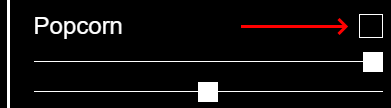
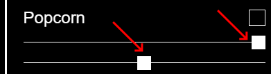

# Configuring Non-Linear Functions

> [!NOTE] This page assumes familiarity with the role of Non-Linear Functions (NLFs) in a fractal flame.
> For an introduction to NLFs, see [here](./what-is-fractalflame.md).

NLFs make up the heart of the fractals built with [FractalFlame](https://xentempest.github.io/FractalFlame/FractalFlame.html). This page includes a detailed instructions on using the interface to configure NLFs; for a quick reference see the [interface overview](./interface-overview.md).

For all tasks on this page, all the relevant controls for configuring NLFs can be found under the **Non-Linear Functions** header in the settings panel:

> [!WARNING] As always, modifying settings will restart the fractal. Remember to save good fractals early and often.

### To Enable or Disable a NLF
1. In the NLF list, click the box immediately across from the name. If the box is filled, then the NLF is active.

2. If **Instant Changes** is not checked, press **Submit Changes** to update the fractal to have the NLF now active.

### To Change a NLF Parameter
If there are sliders under the name of an NLF, it has parameters you can adjust.
1. In the NLF list, under the NLF you wish to modify, move a slider of your choice. To get the default behavior, move the slider to the center.

2. If **Instant Changes** is not checked, press **Submit Changes** to update the fractal to have the new parameter value.