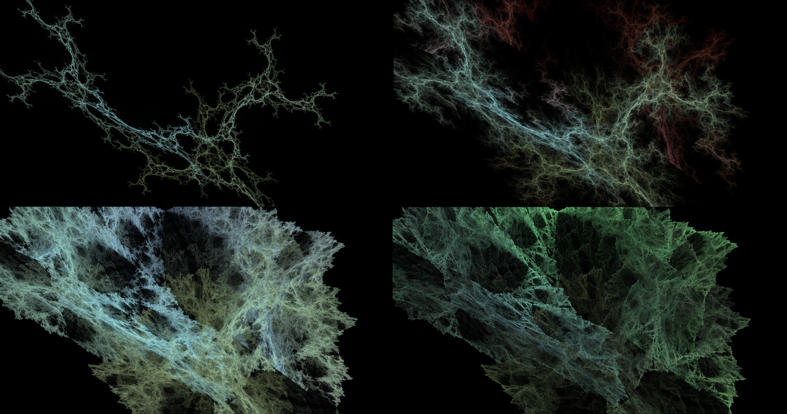

# Function Weighting

> [!NOTE] This page is intended for non-mathematical audiences.
A more detailed explanation can be found [here](./what-is-a-fractal-flame.md#nlf-vs-mat), and an overview of FractalFlame (including these concepts) can be found [here](./what-is-fractalflame.md).

Each Matrix and Non-Linear Function (NLF) in a fractal flame exerts some influence on the resulting image. The strength of this influence is determined by the Matrix/NLF's "Weight". Weights cannot be controlled or seen directly, but they are very important to determining the character of the final fractal.

## Controlling Weights

Though Weights cannot be directly accessed, there are indirect methods. [FractalFlame](https://xentempest.github.io/FractalFlame/FractalFlame.html) has two indirect ways to control Weights.

* **Randomization**: Weights can mainly be controlled through randomization. When not intentionally randomized, the system does its best to keep Weights unchanged while other settings move. 
* **Matrix Weight**: One can directly modify an overall Weight given to Matrices in general. The higher this "Matrix Weight", the more impact Matrices will have (with the opposite effect on NLFs).

> [!INFO] While the system attempts to keep Weights unchanged, they are forgotten when an NLF is disabled. Thus, one can individually randomize an NLF's Weight by toggling it repeatedly.

## Example
The image below shows the effect of different Weightings of the "Julia" NLF on a fractal with 2 Matrices. In left-to-right, top-to-bottom order, the fractals go from the NLF disabled to the NLF with a considerable Weight.

> [!WARNING] Different NLFs may react differently to Weightings, and individual Matrix Weights often only change the brightness of different parts of the fractal. This example should not be taken as representative of all Weighting effects.

