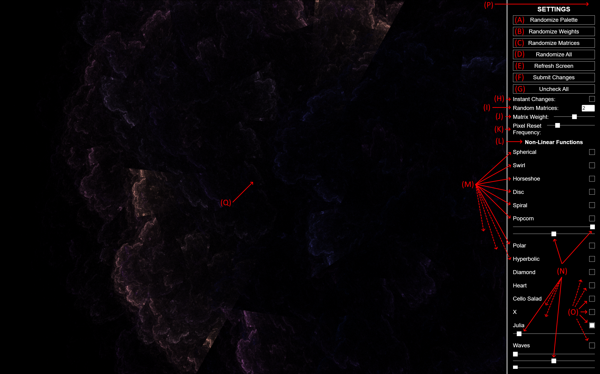
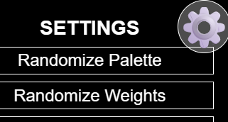
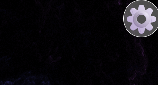

# Interface Overview
> [!NOTE] This overview assumes familiarity with FractalFlame's basic components.
> For a summary of these concepts, please see [What is FractalFlame?](./what-is-fractalflame.md).

This page attempts to answer all quick questions about the interface of [FractalFlame](https://xentempest.github.io/FractalFlame/FractalFlame.html). To find out what a specific option does, look for its letter label in the above screenshot, then read that letter's description in the list below.

As a general word of caution, note that almost all inputs are only reactive if you check the **Instant Changes** checkbox. If **Instant Changes** is unchecked (the default state), then pressing **Submit Changes** (or similar, see below) is required to see the effects of any settings you changed. This is to avoid [accidentally restarting a well-converged flame](./what-is-fractalflame.md#lifecycle).

> [!WARNING] Some features interact in ways you may not expect.
> For common issues, please see the [FAQ](./faq.md).

## General Randomization
These first settings provide large-scale randomization of all major parts of the fractal flame. In standard usage, most time will be spent here and in the **(L) Non-Linear Functions** section.

> [!NOTE] The buttons in this section automatically restart the flame and apply all setting changes made elsewhere in the UI.

**(A) Randomize Palette**: Randomizes the colors associated with each part of the fractal flame.

**(B) Randomize Weights**: Randomizes the Weight (influence) given to all Matrices and NLFs. For more on Weight selection, see [here](./selecting-weights.md).

**(C) Randomize Matrices**: Switches to using *N* new random Matrices, where *N* is the number set in **(I) Random Matrices**.

**(D) Randomize All**: Randomizes Matrices, Weights, and colors in the same way as their associated buttons.

**(E) Refresh Screen**: Clears the screen and starts over fractal rendering.

**(F) Submit Changes**: Does the same thing as **(E) Refresh Screen**.

## Meta Settings

The following settings allow you to control the behavior of other settings or UI.

**(G) Uncheck All**: Disables all currently enabled NLFs.

**(H) Instant Changes**: Enables or disables UI reactivity. If UI reactivity is enabled, all controls (even those outside of "General Randomization") instantly take effect and restart the [fractal convergence process](./what-is-fractalflame.md#lifecycle).

**(I) Random Matrices**: Sets the number *N* of Matrices to use in the fractal flame, though not which specific ones should be used. To generate *N* new random Matrices, use **(C) Randomize Matrices**.

**(J) Matrix Weight**: Sets an overall Weight for Matrices, as opposed to NLFs. For more on Weighting, see [here](./selecting-weights.md).

**(K) Pixel Reset Frequency**: This slider is rarely used and difficult to understand. Roughly, moving it to the right will add more fine detail to the fractal, at the cost of a longer [convergence time](./what-is-fractalflame.md#lifecycle).

## Non-Linear Functions
The following settings all relate to selecting and configuring NLFs. For a deeper explanation of how to use these controls, see [here](./configuring-nlfs.md).

**(L) Non-Linear Functions**: Marks the end of the rest of the UI. The only UI after this point is a list of the over two dozen available NLFs.

**(M),** ***NLF Names***: Labels the parameter sliders and toggle box for each available NLF. These names are used throughout the documentation to refer to specific NLFs.

**(N)**, ***NLF Parameters***: Fine-tunes the behavior of the NLF immediately above it. Many NLFs do not have any parameter sliders.

**(O)**, ***NLF Toggle***: Enables or disables an NLF. A disabled NLF has no impact on the fractal.

## Miscellaneous

**(P)**, ***Show/Hide Settings***: Hovering the mouse in the labeled area at any time will show a gear icon which can be used to show and hide the settings.

With Settings Open | With Settings Closed
--- | ---
 | 

**(Q)**, ***Export Fractal***: Can be right-clicked. See [Saving a Fractal](./saving-a-fractal.md) for how to use this.

## See Also
* [FAQ](./faq.md)
* [What is FractalFlame?](./what-is-fractal-flame.md)
* [Configuring NLFs](./configuring-nlfs.md)
* [Selecting Weights](./choosing-weights.md)