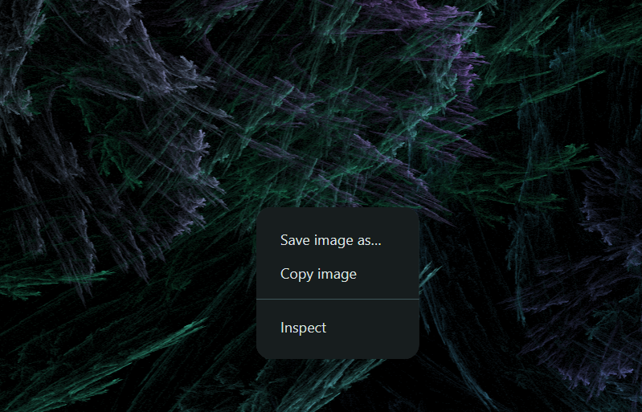

# Saving a Fractal
As mentioned in [What is FractalFlame?](./what-is-fractalflame.md#lifecycle), fractal flames are never truly "done," they merely get sharper and sharper over time. A such, they can be exported at any time:

1. Right-click the fractal image itself, as shown in the image. A context menu opens:

> [!NOTE] This menu may look slightly different depending on your operating system.
2. Choose the appropriate option from the menu:
	* If you want your fractal as a image, choose the **Save image as...** option.
	* If you want your fractal in your clipboard, choose the **Copy image** option.