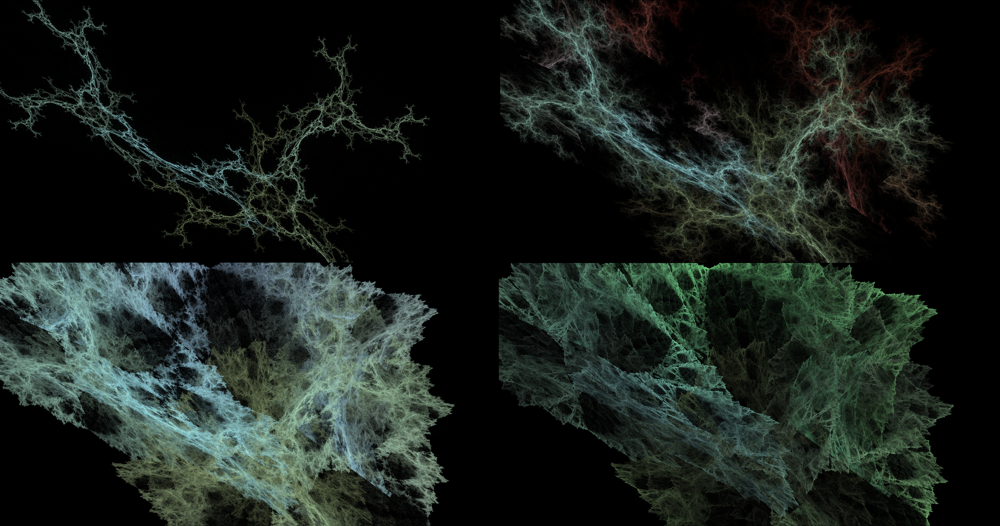
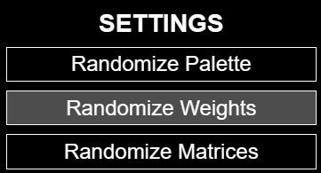
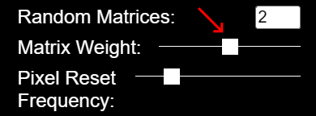

# Selecting Weights
> [!NOTE] This page assumes familiarity with the role of Weights in FractalFlame.
> For an introduction to Weights, see [here](./what-is-fractalflame.md), or [here for more detail](./function-weighting.md).

Even with identical Matrices and NLFs, different Weights can produce wildly fractal flames. For example, the four fractals below differ only in Weighting (and slightly in palettes):

However, Weights are not directly chosen, but rather influenced in two ways:

* To randomize all Weights, choose the **Randomize Weights** option near the top of the settings panel. Note that this will also restart the fractal, so remember to [save your fractal](./saving-a-fractal.md) if you don't want to lose it.

* To adjust the Weight of Matrices vs. NLFs, move the Matrix Weight slider under **Random Matrices** in the settings panel. Moving the slider all the way to the right gives a Weight of 0 to all NLFs, so only Matrices have an influence on the fractal.

> [!NOTE] Note
> Changing the Matrix Weight will have no immediate effect unless **Instant Changes** is checked or you press **Submit Changes**.