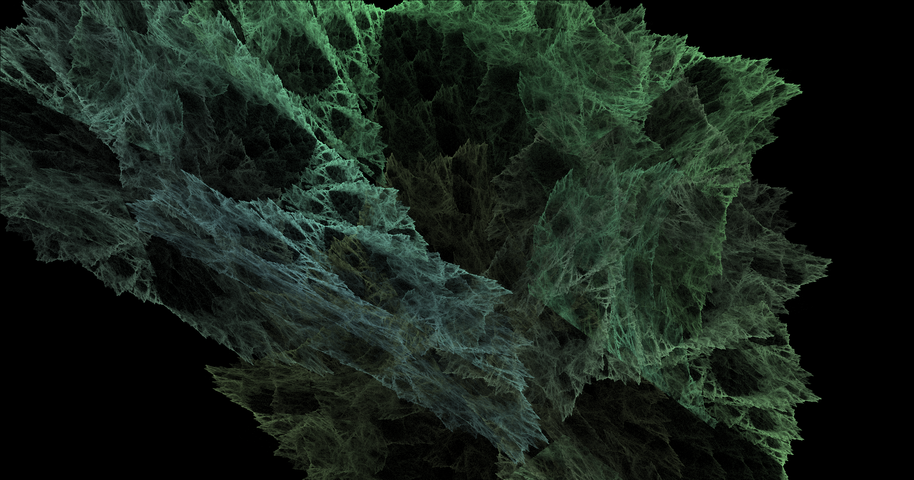
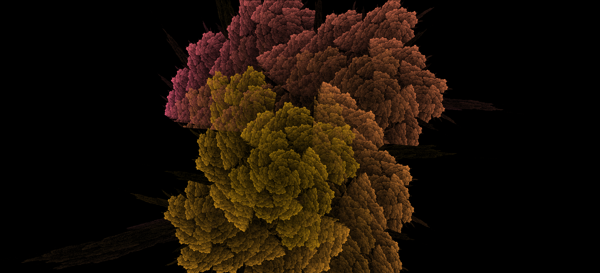
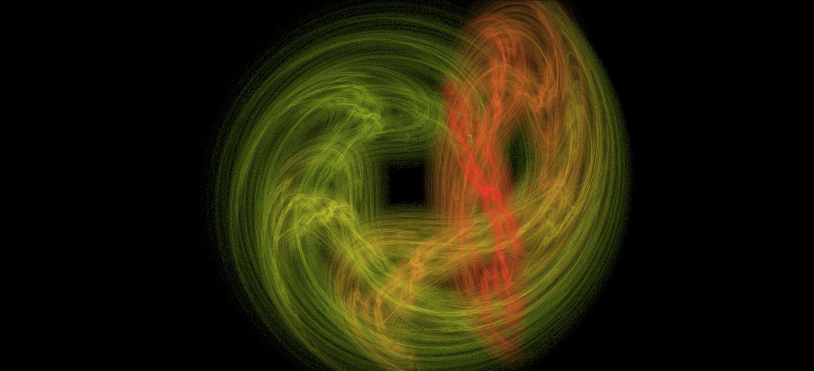
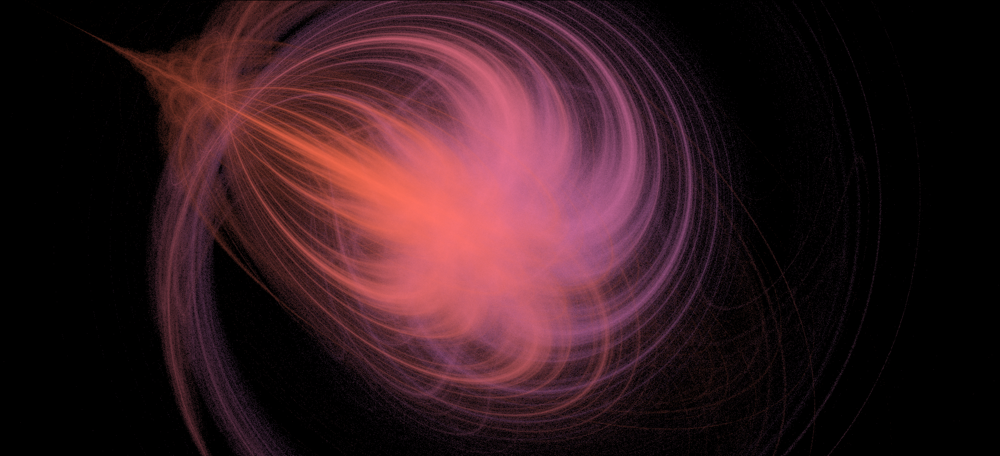
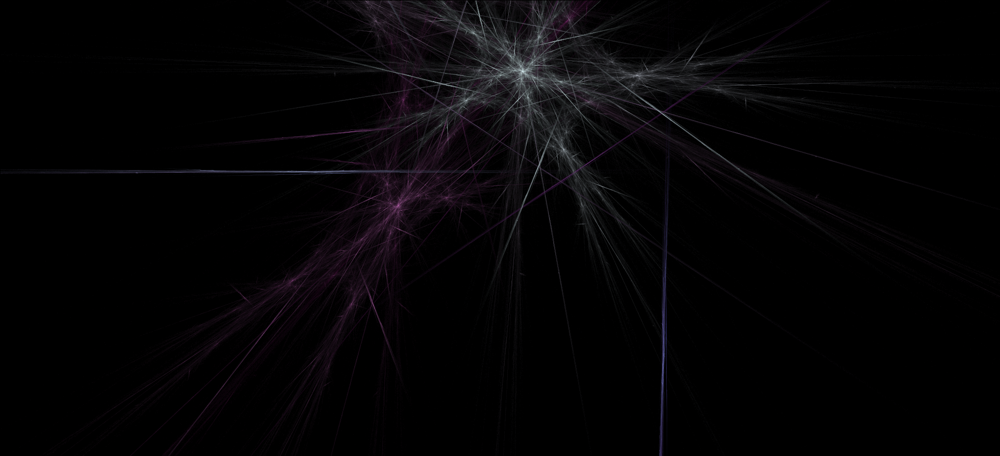
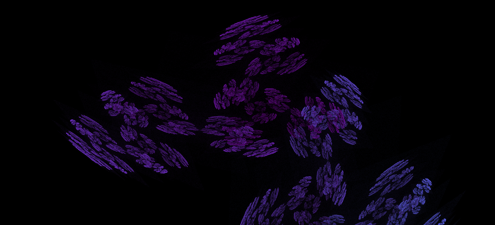
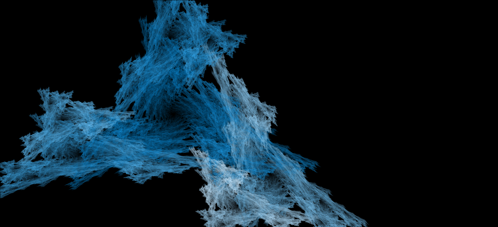
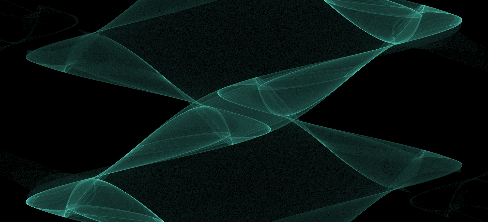
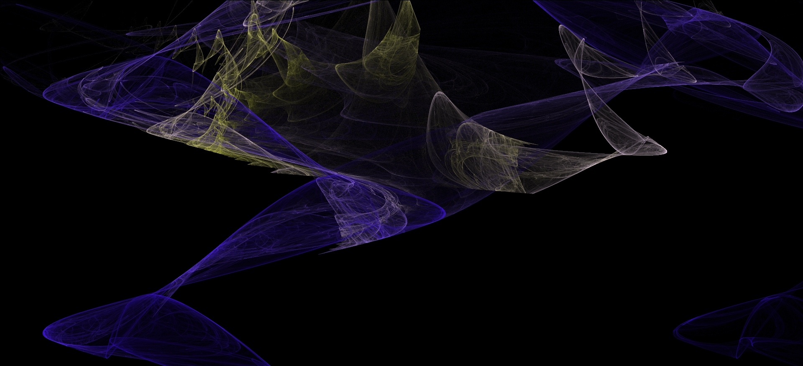

# What is FractalFlame?
[FractalFlame](https://xentempest.github.io/FractalFlame/FractalFlame.html) is an online tool for creating and customizing a type of [algorithmic art](https://en.wikipedia.org/wiki/Algorithmic_art) called [fractal flames](what-is-a-fractal-flame.md). With over 100 million options and a simplified interface, FractalFlame can be used to produce an endless stream of beautifully detailed images for use as screensavers, backgrounds, and profile pictures. Each fractal flame consists of four parts, which can each be customized/randomized separately:

1. **Color Palette**: The set of colors used in the fractal. Colors are tied to the structure of the image, creating more aesthetically pleasing results.
2. **Non-Linear Functions (NLFs)**: These are mathematical objects which determine the character and details of the fractal. These are human-authored and lead to complex and unique effects. FractalFlame has 25+ NLFs to mix and match, leading to near-infinite possible variations.
3. **Matrices**: Similar to NLFs, these objects determine the overall shape of the fractal. There are infinite Matrices, and all of them can be used in FractalFlame. For more on the mathematical distinctions between NLFs and Matrices, see [here](non-linear-functions-vs-Matrices.md).
4. **Weights**: Each NLF and Matrix has an associated Weight, which determines how much influence it has on the shape of the fractal. By adjusting Weights, a whole family of similar fractal flames can be explored. For more mathematical information on Weights, see [here](function-weighting.md).

## What You Can Do With FractalFlame
* Choose any number of named NLFs and tune them to a desired outcome. Note that many NLFs have associated configurable sliders which change their effect on the fractal.
* Choose a number of Matrices to be randomly generated for use in the fractal. These will be regenerated as needed, but won't change if not explicitly modified.
* Randomize the Weights, color palettes, and specific Matrices of the fractal, as a method of exploring the infinite possibility space.

## What You Can't Do With FractalFlame
FractalFlame is designed to have a very simple interface. As such, some customizations are out of scope for the project, so one cannot:
* Choose the specific Matrices used. Only the amount can be set and the Matrices can be randomized.
* Choose the specific Weights used. Though every Matrix and NLF has a Weight, the only way to change them is through complete randomization or a general Weight for all Matrices.
* Choose the specific color palette used. The same restrictions on Weight customization apply here.

> [!NOTE] These features are not present, but may be added in a future release of FractalFlame.

## Lifecycle of a Fractal Flame
Even once the system knows which NLFs and Matrices to use, it takes considerable computational power to produce an image of the fractal. However, to avoid the boredom of the wait, FractalFlame shows you intermediate versions of the image as it is computed. This causes it to appears blocky or grainy at first when given new settings.

As time passes, the system refines the image further and further in a process called convergence. There is no well-defined final state for a fractal flame, which has two important consequences:
1. It is merely a matter of personal choice when the image is "done," and it can be exported at any time.
2. Any fractal flame can become sharper given more time (up to a theoretical limit of around 77 hours).

> [!NOTE] If a fractal looks too fuzzy or indistinct, try giving it 10 or 20 more seconds. You may be surprised at the beauty underneath.

> [!WARNING] Since changing settings requires the fractal image to be reset and reconverge, a well-converged fractal can easily be lost. Save fractals you enjoy early and often.

## Examples
In the remainder of this page, images show examples of the fractal flames that can be achieved with various settings of Matrices and NLFs. Note that the following set of images is not even close to representative, and many entire categories of fractal flames are not shown here.

> [!NOTE] Even with identical settings, multiple vastly different flames can be achieved.

### 2 Matrices + "Julia" NLF

### 1 Matrix + "Swirl" NLF

### 3 Matrices + 0 NLFs

### 0 Matrices + "Waves" NLF

### 0 Matrices + "Waves" NLF + "Julia" NLF

Want to see more of these? Try [FractalFlame](https://xentempest.github.io/FractalFlame/FractalFlame.html) yourself!